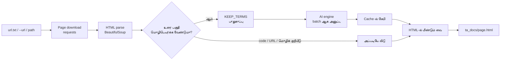
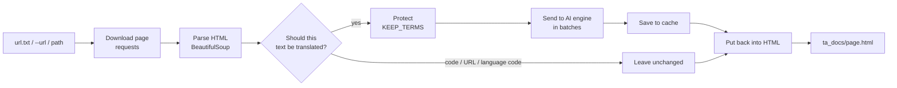

# Static Page Translate with AI

**ஆங்கிலம் → தமிழ் (default) · 37+ மொழிகள் · Open Source · Apache-2.0**

🌐 **[English instruction below](#english-instructions)** · 📖 [தமிழ் வழிகாட்டி](#tamil-instructions)


## 🙏 நன்றி (Thanks)

- 🌌 **பிரபஞ்சம்** (the Universe)
- 🧑‍💻 **திரு. T. ஸ்ரீனிவாசன்** — கனியம் நிர்வாகி (Kaniyam administrator, Mr. T. Shrinivasan) [Wordpress](https://goinggnu.wordpress.com/) | [கணியம்](https://kaniyam.com/)
- 🤖 **செய்யறிவு ஆசான் திரு. சையது ஜாபர்** (my AI teacher, Mr. K. Syed jafer) — [GitHub](https://github.com/syedjaferk/) | [Parottasalna](https://parottasalna.com/)
- ✨ **Anthropic** — Claude Sonnet 5.5 (free)
- ⚡ **Groq**
- 🔷 **Google Products & Gemini**
- 🐧 **கஞ்சி Linux குழு லினக்ஸ் உறுப்பினர்கள்** (Kanchi Linux group members)
- 👩‍💻 அனைத்து **வன்பொருள், மென்பொருள்  உருவாக்குநர்கள்** (All Hardware and software developers)
- 🌍 இணைய வழங்குநர்கள் (internet providers) · 🔌 மின்சார வழங்குநர்கள் (electricity suppliers)
- 👨‍👩‍👧 குடும்பத்தினர் (family) · 🤝 நண்பர்கள் (friends) · 🎓 ஆசிரியர்கள் (teachers) · 🌾 விவசாயிகள் (farmers)
- 🌱 **அனைத்து கனிமங்களும், உயிரினங்களுக்கும் நன்றிகள் ** (Thanks to all minerals and living beings.) 🙏

## 🎯 நோக்கம் (Purpose)

இந்த கருவி **நிரலாக்க ஆவணங்களைத் தனக்கு விருப்பமான மொழியில் வாசிப்பதற்காக மட்டுமே** உருவாக்கப்பட்டது. பயனர்களும் அதே நோக்கத்துக்காகப் பயன்படுத்துவீர்கள் என எதிர்பார்க்கிறோம். இந்தத் திட்டம் **Django ஆவணத்தை வாசிக்கும் நோக்கில்** தொடங்கப்பட்டது.

*This tool was created **only to read programming documentation in one's own preferred language**. We expect users to use it for the same purpose. The project began with the aim of reading the **Django documentation**.*

> இது ஒரு எதிர்பார்ப்பு மட்டுமே; உரிமம் மாறவில்லை — **Apache-2.0**. *(This is an expectation, not an extra license condition; the license remains Apache-2.0.)*

<a id="disclaimer"></a>

## ⚠️ மறுப்பு அறிவிப்பு (Disclaimer)

> ### ⚠️ கவனிக்கவும் / PLEASE NOTE
>
> **மொழிபெயர்ப்பின் தரமும் நம்பகத்தன்மையும் நீங்கள் தேர்வு செய்யும் செய்யறிவை (AI) சார்ந்துள்ளது. இது கற்றல் பயன்பாட்டுக்கானது மட்டுமே.**
>
> AI முடிவுகளில் **பிழைகள், கற்பனையான தகவல்கள் (hallucinations) மற்றும் புனையப்பட்ட விஷயங்கள்** இருக்கலாம் என்பதைக் கவனத்தில் கொள்ளுங்கள். முக்கியமானவற்றை எப்போதும் அசல் ஆவணத்துடன் ஒப்பிட்டுச் சரிபார்க்கவும்.
>
> **English:** *The quality and reliability of the translation depend on the AI you choose. This is for learning purposes only. AI output may contain errors, hallucinated (imaginary) information and fabricated content — please keep this in mind, and always verify important details against the original document.*

---

<a id="tamil-instructions"> </a>

# தமிழ் வழிகாட்டி (Tamil Guide)

[English instruction below ↓ Click here](#english-instructions)

> **Web page-களை (documentation, tutorial, blog) AI மூலம் நீங்கள் விரும்பும் மொழிக்கு மொழிபெயர்த்து, அதே HTML வடிவத்தில் தரும் திறந்த மூல (open source) command-line கருவி. Default: ஆங்கிலம் → தமிழ்.**
> Code blocks மொழிபெயர்க்கப்படாது; `model`, `view`, `URL` போன்ற technical சொற்கள் மூல வடிவிலேயே (ஆங்கிலத்தில்) இருக்கும்.

---

## ✨ புதிய வசதிகள் (What's New)

| வசதி | விளக்கம் | எப்படி |
|---|---|---|
| 🌐 **பல மொழிகள்** | எந்த மொழியிலிருந்து எந்த மொழிக்கும்; உள்ளமைந்த அட்டவணையில் 37 மொழிகள் (LLM engine-களில் வேறு குறியீடுகளும் வேலை செய்யும்) | `-s en -t ta` |
| 🔎 **மூல மொழி கண்டறிதல்** | மூல மொழியைத் தானாகக் கண்டறி (google / LLM engine-கள்) | `-s auto` |
| ↔️ **RTL மொழிகள்** | அரபு, உருது, பாரசீகம், ஹீப்ரு வெளியீட்டில் `dir="rtl"` தானாகச் சேரும் | `-t ar` |
| 📋 **மொழி அட்டவணை** | ஆதரிக்கப்படும் மொழிக் குறியீடுகளைக் காட்டும் | `--list-languages` |
| 📁 **வெளியீட்டு folder** | விருப்பமான folder-ல் சேமிக்க | `--out my_folder` |
| 📄 **`url.txt` batch** | பல URL-களை ஒன்றன் பின் ஒன்றாக; ஒன்று தோல்வியடைந்தாலும் தொடரும் | `python ... --engine groq` |
| 🔤 **`KEEP_TERMS.txt`** | ஆங்கிலத்திலேயே இருக்க வேண்டிய கூடுதல் சொற்கள்; காலியெனில் default பட்டியல் | `--replace-terms` |
| 🔑 **`.env` ஆதரவு** | API key-களை கோப்பில் வைக்கலாம் | பிரிவு 6 |
| ⚡ **Groq engine** | இலவச key, மிக வேகம் | `--engine groq` |
| 🦙 **Ollama மேம்பாடு** | Offline LLM; strict JSON output, பெரிய context | `--engine ollama` |
| 📦 **`--batch`** | குறைவான requests (quota சேமிப்பு) | `--batch 80` |
| ♻️ **`--seed`, `--skip-done`** | முடிந்தவற்றை மீண்டும் பயன்படுத்து / தவிர் | `--seed gemini` |
| 🛡️ **புத்திசாலி rate-limit கையாளுதல்** | `retry-after`-ஐப் பின்பற்றும்; தினசரி quota முடிந்தால் தெளிவாக நிறுத்தும்; timeout-ல் batch-ஐப் பிரிக்கும் | தானாக |
| 🧹 **தானாக மீண்டும் முயலுதல்** | ஆங்கிலத்திலேயே விடப்பட்ட பகுதிகள் அடுத்த முறை மீண்டும் முயலப்படும் | தானாக |
| ⚖️ **Apache License 2.0** | முழு உரிமம், `NOTICE` கோப்புடன் | `LICENSE` |

---

## உள்ளடக்கம் (Table of Contents)

0. [நன்றி](#-நன்றி-thanks) · [நோக்கம்](#-நோக்கம்-purpose) · [மறுப்பு அறிவிப்பு](#disclaimer) · [புதிய வசதிகள்](#-புதிய-வசதிகள்-whats-new)
1. [சிறப்பம்சங்கள்](#1-சிறப்பம்சங்கள்)
2. [எப்படி வேலை செய்கிறது](#2-எப்படி-வேலை-செய்கிறது)
3. [தேவைகள்](#3-தேவைகள்-requirements)
4. [நிறுவல்](#4-நிறுவல்-installation)
5. [கோப்பு அமைப்பு](#5-கோப்பு-அமைப்பு)
6. [`.env` கோப்பு எழுதும் முறை](#6-env-கோப்பு-எழுதும்-முறை)
7. [விரைவுத் தொடக்கம்](#7-விரைவுத்-தொடக்கம்-quick-start) (7.1 [மொழிகளை மாற்றுதல்](#71-மொழிகளை-மாற்றுதல்---source----target))
8. [`url.txt` – பல பக்கங்கள் (batch)](#8-urltxt--பல-பக்கங்கள்-batch)
9. [`KEEP_TERMS.txt` – ஆங்கிலத்திலேயே இருக்கும் சொற்கள்](#9-keep_termstxt--ஆங்கிலத்திலேயே-இருக்கும்-சொற்கள்)
10. [கட்டளை வரி விருப்பங்கள்](#10-கட்டளை-வரி-விருப்பங்கள்-options)
11. [Engine-களின் ஒப்பீடு](#11-engine-களின்-ஒப்பீடு)
12. [Cache, தொடர்தல், `--seed`](#12-cache-தொடர்தல்---seed)
13. [Rate limit / quota குறிப்புகள்](#13-rate-limit--quota-குறிப்புகள்)
14. [சிக்கல் தீர்வு](#14-சிக்கல்-தீர்வு-troubleshooting)
15. [வரம்புகள்](#15-வரம்புகள்-limitations)
16. [தனிப்பயனாக்கம்](#16-தனிப்பயனாக்கம்-customization)
17. [Open source: உரிமம், பங்களிப்பு, பொறுப்பான பயன்பாடு](#17-open-source-உரிமம்-பங்களிப்பு-பொறுப்பான-பயன்பாடு)
18. [இணைப்பு (Appendix)](#18-இணைப்பு-appendix)

---

## 1. சிறப்பம்சங்கள்

| வசதி | விளக்கம் |
|---|---|
| **பல மொழிகள்** | `-s` (மூலம்) / `-t` (இலக்கு); default `en → ta` |
| **அதே வடிவம்** | அசல் HTML (headings, tables, CSS) மாறாது; உரை மட்டும் மொழிபெயர்க்கப்படும் |
| **Code பாதுகாப்பு** | `pre`, `code`, `kbd`, `samp`, `var` போன்றவை மொழிபெயர்க்கப்படாது |
| **Technical சொற்கள்** | `KEEP_TERMS` பட்டியலில் உள்ளவை மூல வடிவிலேயே இருக்கும் |
| **AI engine தேர்வு** | `groq` (முதல் தெரிவு), `gemini`, `claude`, `ollama` (offline), `nllb` (offline), `google` |
| **Batch** | `url.txt`-ல் பல URL-களை ஒன்றன் பின் ஒன்றாக மொழிபெயர்க்கும் |
| **Cache** | முடிந்த பகுதிகள் சேமிக்கப்படும்; நின்றாலும் தொடரலாம் |
| **Rate limit கையாளுதல்** | தானாகக் காத்திருந்து மீண்டும் முயலும்; தினசரி quota முடிந்தால் தெளிவாக நிறுத்தும் |
| **`.env` ஆதரவு** | API key-களை கோப்பில் வைக்கலாம் |

---

## 2. எப்படி வேலை செய்கிறது



1. பக்கத்தை பதிவிறக்கம் செய்கிறது; `<base href>` சேர்ப்பதால் CSS/படங்கள் சரியாக ஏற்றப்படும்.
2. ஒவ்வொரு உரைப் பகுதியையும் (text node) சேகரித்து, code/URL/மொழிக் குறியீடுகளை நீக்குகிறது.
3. பல பகுதிகளை ஒரே request-ல் (batch) engine-க்கு அனுப்புகிறது.
4. பதிலை cache-ல் சேமித்து, HTML-ல் மீண்டும் பொருத்தி, `ta_docs/` folder-ல் எழுதுகிறது.

---

## 3. தேவைகள் (Requirements)

- **Python 3.9 அல்லது அதற்கு மேல்**
- இணைய இணைப்பு (`ollama` / `nllb` engine-க்கு மொழிபெயர்ப்பின்போது தேவையில்லை)
- ஒரு engine-க்கான key அல்லது மென்பொருள்:

| Engine | தேவை |
|---|---|
| `groq` | `GROQ_API_KEY` (இலவச key கிடைக்கும்) |
| `gemini` | `GEMINI_API_KEY` (இலவச key கிடைக்கும்) |
| `claude` | `ANTHROPIC_API_KEY` (கட்டணம்) |
| `ollama` | [Ollama](https://ollama.com) நிறுவப்பட்டு இயங்க வேண்டும் + ஒரு chat model |
| `nllb` | `pip install transformers torch sentencepiece` (≈2.5 GB model பதிவிறக்கம்) |
| `google` | `pip install deep-translator` (key தேவையில்லை; எளிதில் block ஆகலாம்) |

Python packages: **கட்டாயம்** `requests`, `beautifulsoup4`. மற்றவை தேர்ந்தெடுக்கும் engine-ஐப் பொறுத்தது.

---

## 4. நிறுவல் (Installation)

```bash
# 1. Project folder-க்குள் செல்லுங்கள்
cd static-page-translate

# 2. Virtual environment உருவாக்குங்கள்
python3 -m venv .venv

# 3. செயல்படுத்துங்கள் (உங்கள் shell-க்கு ஏற்றதை பயன்படுத்துங்கள்)
source .venv/bin/activate          # bash / zsh
source .venv/bin/activate.fish     # fish
# .venv\Scripts\activate           # Windows (cmd / PowerShell)

# 4. Packages நிறுவுங்கள்
pip install requests beautifulsoup4
pip install deep-translator        # 'google' engine பயன்படுத்தினால் மட்டும்
```

அல்லது `requirements.txt` மூலம் (இணைப்பைப் பார்க்கவும்):

```bash
pip install -r requirements.txt
```

---

## 5. கோப்பு அமைப்பு

```text
static-page-translate/
├── static_page_translate_with_ai.py   ← முதன்மை script
├── url.txt                    ← மொழிபெயர்க்க வேண்டிய URL பட்டியல்
├── KEEP_TERMS.txt             ← கூடுதலாக ஆங்கிலத்திலேயே வைக்க வேண்டிய சொற்கள்
├── .env                       ← உங்கள் API key (git-ல் சேர்க்க வேண்டாம்!)
├── .env.example               ← key இல்லாத மாதிரி கோப்பு (git-ல் சேர்க்கலாம்)
├── requirements.txt
├── .gitignore
├── LICENSE                    ← Apache License 2.0 (முழு உரை)
├── NOTICE                     ← பதிப்புரிமை அறிவிப்பு
├── README.md                  ← இந்த கையேடு
└── ta_docs/                   ← தானாக உருவாகும் வெளியீடு (தமிழ் அல்லாத இலக்குக்கு docs_<மொழி>/)
    ├── intro_tutorial01.html
    ├── cache_groq.json        ← ஒவ்வொரு engine / மொழிச் சோடிக்கும் தனி cache
    └── ...
```
---

## 6. `.env` கோப்பு எழுதும் முறை

`.env` என்பது உங்கள் ரகசிய API key-களை வைக்கும் எளிய உரைக் கோப்பு. Script தொடங்கும்போது இதைத் தானாகப் படிக்கும்.

### 6.1 உருவாக்குதல்

Script இருக்கும் folder-லேயே (அல்லது நீங்கள் கட்டளையை இயக்கும் folder-ல்) உருவாக்குங்கள்:

```bash
touch .env
nano .env          # அல்லது எந்த text editor-ம் பயன்படுத்தலாம்
```

அல்லது ஒரே கட்டளையில்:

```bash
echo 'GROQ_API_KEY=உங்கள்_key' > .env
```

> கோப்புப் பெயர் **சரியாக `.env`** இருக்க வேண்டும் (முன்னால் புள்ளி உண்டு, `.txt` சேர்க்கக் கூடாது). Linux file manager-ல் புள்ளியால் தொடங்கும் கோப்புகள் மறைந்திருக்கும் (`Ctrl+H` மூலம் காணலாம்).

### 6.2 வடிவம் (Format)

```ini
# இது ஒரு கருத்து (comment) - புறக்கணிக்கப்படும்

GROQ_API_KEY=gsk_.................................
GEMINI_API_KEY=AIza................................
ANTHROPIC_API_KEY=sk-ant-.........................

# விருப்பத்துக்குரியது: Gemini model பெயர்
GEMINI_MODEL=gemini-3.1-flash-lite
```

| விதி | விளக்கம் |
|---|---|
| ஒரு வரிக்கு ஒன்று | `பெயர்=மதிப்பு` |
| `=`-க்கு இருபுறமும் **இடைவெளி கூடாது** | ✅ `KEY=abc`   ❌ `KEY = abc` |
| Quotes தேவையில்லை | `KEY="abc"` என எழுதினாலும் ஏற்கும் |
| `#` வரிகள் கருத்துகள் | வரியின் தொடக்கத்தில் மட்டும். **மதிப்புக்குப் பின் comment எழுதாதீர்கள்** (`KEY=abc # note` என்றால் `# note`-உம் key-யில் சேரும்) |
| வெற்று வரிகள் அனுமதிக்கப்படும் | |
| `export KEY=abc` ஏற்கப்படும் | bash பழக்கம் உள்ளவர்களுக்காக |
| முன்னுரிமை | Terminal-ல் ஏற்கனவே அமைத்த environment variable `.env`-ஐ விட முன்னுரிமை பெறும் |
| தேடும் இடம் | முதலில் நீங்கள் கட்டளையை இயக்கும் folder, பின்னர் script இருக்கும் folder |

### 6.3 ஆதரிக்கப்படும் மாறிகள்

| மாறி (Variable) | எதற்கு | key எங்கே பெறுவது |
|---|---|---|
| `GROQ_API_KEY` | `groq` engine | <https://console.groq.com> |
| `GEMINI_API_KEY` | `gemini` engine | <https://aistudio.google.com/apikey> |
| `GEMINI_MODEL` | Gemini model பெயரை மாற்ற (விருப்பம்) | `--engine gemini --list-models` மூலம் பாருங்கள் |
| `ANTHROPIC_API_KEY` | `claude` engine | <https://console.anthropic.com> |

`ollama`, `nllb`, `google` engine-களுக்கு key தேவையில்லை.

### 6.4 `.env` இல்லாமல் (terminal-ல் நேரடியாக)

```bash
export GROQ_API_KEY=உங்கள்_key        # bash / zsh
set -x GROQ_API_KEY உங்கள்_key        # fish
```

### 6.5 பாதுகாப்பு — மிக முக்கியம்

- `.env`-ஐ **ஒருபோதும் GitHub-ல் பதிவேற்றாதீர்கள்.** `.gitignore`-ல் `.env` சேர்க்கவும் (இணைப்பைப் பார்க்கவும்).
- Key-ஐ screenshot-ல், chat-ல், மின்னஞ்சலில் பகிராதீர்கள்.
- Linux/macOS-ல் கோப்பை உங்களுக்கு மட்டும் படிக்கும்படி வைக்கலாம்: `chmod 600 .env`
- Key கசிந்துவிட்டால், உடனே அந்த வழங்குநரின் தளத்தில் அதை **நீக்கி (revoke) புதிய key** உருவாக்குங்கள்.
- Git-ல் பகிர `.env.example` (உண்மையான key இல்லாமல்) பயன்படுத்துங்கள்.

---

## 7. விரைவுத் தொடக்கம் (Quick Start)

```bash
# 1) Packages + .env தயார் (பிரிவு 4, 6)

# 2) ஒரு பக்கத்தை சோதிக்கவும்
python static_page_translate_with_ai.py --engine groq intro/tutorial01/

# 3) முடிவைத் திறந்து பாருங்கள்
xdg-open ta_docs/intro_tutorial01.html      # Linux
# open ta_docs/intro_tutorial01.html        # macOS
```

சரியாக இருந்தால் முழு Django tutorial (பகுதி 1–7):

```bash
python static_page_translate_with_ai.py --engine groq --tutorial
```

எந்த web page-ஐயும்:

```bash
python static_page_translate_with_ai.py --engine groq --url https://realpython.com/django-setup/
```

`--engine` கொடுக்காமல் இயக்கினால் terminal-ல் engine தேர்வு பட்டியல் (menu) வரும்; Enter மட்டும் அழுத்தினால் `groq` தேர்வாகும்.

**Django docs path:** `intro/tutorial01/` என்பது `https://docs.djangoproject.com/en/stable/intro/tutorial01/` என விரியும்.

---

### 7.1 மொழிகளை மாற்றுதல் (`--source` / `--target`)

Default `en → ta`. வேறு மொழிக்கு `-s` (source) மற்றும் `-t` (target) கொடுங்கள்:

```bash
# ஆதரிக்கப்படும் மொழிக் குறியீடுகள்
python static_page_translate_with_ai.py --list-languages

# ஆங்கிலம் → சிங்களம்
python static_page_translate_with_ai.py -t si --engine groq --url https://example.com/guide

# பிரெஞ்சு → தமிழ்
python static_page_translate_with_ai.py -s fr -t ta --engine groq --url https://example.fr/page

# மூல மொழியைத் தானாகக் கண்டறிந்து → இந்தி
python static_page_translate_with_ai.py -s auto -t hi --engine groq --url https://example.com/

# முழு tutorial → தெலுங்கு, வெளியீடு my_te/ folder-ல்
python static_page_translate_with_ai.py -t te --engine groq --tutorial --out my_te
```

| மொழிக் குறியீடுகள் (சில) | |
|---|---|
| `en` English · `ta` Tamil · `si` Sinhala · `hi` Hindi · `te` Telugu · `ml` Malayalam · `kn` Kannada | `mr` Marathi · `bn` Bengali · `gu` Gujarati · `pa` Punjabi · `ur` Urdu · `ne` Nepali |
| `fr` French · `de` German · `es` Spanish · `it` Italian · `pt` Portuguese · `ru` Russian · `nl` Dutch | `ar` Arabic · `fa` Persian · `he` Hebrew · `tr` Turkish · `id` Indonesian · `ms` Malay |
| `zh` Chinese (Simplified) · `zh-TW` Chinese (Traditional) · `ja` Japanese · `ko` Korean · `th` Thai · `vi` Vietnamese | `uk` Ukrainian · `pl` Polish · `sv` Swedish · `el` Greek · `sw` Swahili |

**Engine வாரியாக மொழி ஆதரவு**

| Engine | மொழி ஆதரவு |
|---|---|
| `groq`, `gemini`, `claude`, `ollama` (LLM) | **எந்த மொழிக் குறியீடும்/பெயரும்** (அட்டவணையில் இல்லாவிட்டாலும் முயலும்); `-s auto` ஆதரவு |
| `google` | Google Translate குறியீடுகள்; `-s auto` ஆதரவு |
| `nllb` | உள்ளமைந்த அட்டவணை மொழிகள் மட்டும்; `-s auto` **இல்லை** |

**அறிந்து கொள்ள வேண்டியவை**

- வெளியீடு: இலக்கு `ta` எனில் `ta_docs/`, இல்லையெனில் `docs_<குறியீடு>/` (`--out` மூலம் மாற்றலாம்).
- Cache: ஒவ்வொரு மொழிச் சோடிக்கும் தனி கோப்பு (எ.கா. `cache_groq_fr-ta.json`). பழைய `en → ta` cache கோப்புகள் அப்படியே தொடர்ந்து வேலை செய்யும். `--seed` அதே மொழிச் சோடிக்குள் மட்டும் பொருந்தும்.
- அரபு, உருது, பாரசீகம், ஹீப்ரு இலக்குகளுக்கு `<html dir="rtl">` தானாகச் சேரும்.
- `KEEP_TERMS` சொற்கள் எந்த இலக்கு மொழியிலும் மூல வடிவிலேயே (ஆங்கிலத்தில்) இருக்கும். வேறு தலைப்புக்கு `KEEP_TERMS.txt` / `--replace-terms` பயன்படுத்துங்கள்.
- குறைந்த தரவுள்ள மொழிகள்/சோடிகளில் தரம் குறையலாம்; முதலில் ஒரு பக்கத்தை சோதியுங்கள்.

---

## 8. `url.txt` – பல பக்கங்கள் (batch)

ஒவ்வொரு வரியிலும் ஒரு URL:

```text
# '#' உடன் தொடங்கும் வரிகள் புறக்கணிக்கப்படும்
https://docs.djangoproject.com/en/stable/topics/db/models/
https://realpython.com/django-setup/

# https:// இல்லாத Django docs path-உம் ஏற்கப்படும்
intro/tutorial03/
intro/tutorial04/
```

இயக்குதல்:

```bash
python static_page_translate_with_ai.py --engine groq
```

- வேறு எந்தப் பக்கமும் கொடுக்காவிட்டால், `url.txt` தானாகப் படிக்கப்படும்.
- வேறு கோப்பு: `--url-file my_urls.txt`
- பிரதி (duplicate) URL-கள் நீக்கப்படும்.
- ஒரு URL தோல்வியடைந்தாலும் மற்றவை தொடரும்; இறுதியில் தோல்வியடைந்தவற்றின் பட்டியல் காட்டப்படும்.
- ஏற்கனவே முடிந்தவற்றைத் தவிர்க்க: `--skip-done`
- Quota முடிந்தால் script நிறுத்தப்பட்டு, சேமித்தவை cache-ல் இருக்கும். அதே கட்டளையை மீண்டும் இயக்கினால் தொடரும்.

---

## 9. `KEEP_TERMS.txt` – ஆங்கிலத்திலேயே இருக்கும் சொற்கள்

Script-ல் Django-க்கான **default பட்டியல்** உள்ளது (`Django`, `model`, `view`, `template`, `migration`, `QuerySet`, `URLconf`, `manage.py` …). கூடுதல் சொற்களை `KEEP_TERMS.txt`-ல் எழுதுங்கள்:

```text
# ஒரு வரிக்கு ஒரு சொல், அல்லது comma-வால் பிரித்து பல சொற்கள்
Flask
blueprint, route
Jinja2
```

| நிலை | விளைவு |
|---|---|
| கோப்பு இல்லை / காலி / `#` வரிகள் மட்டும் | **default பட்டியல் மட்டும்** பயன்படும் |
| சொற்கள் உள்ளன | default பட்டியலுடன் **சேர்க்கப்படும்** |
| சொற்கள் உள்ளன + `--replace-terms` | **உங்கள் சொற்கள் மட்டும்** (default நீக்கப்படும்) |

- வேறு கோப்பு: `--keep-file my_terms.txt`
- ஒரு முறை மட்டும்: `--keep "Flask,blueprint"`
- தொடக்கத்தில் `keep terms: 87 (87 built-in, 0 from KEEP_TERMS.txt)` போன்ற வரி எண்ணிக்கையைக் காட்டும்.

> **குறிப்பு:** `google` / `nllb` engine-கள் இந்த சொற்களை placeholder மூலம் பாதுகாக்கின்றன; அது எப்போதாவது தவறலாம். `gemini` / `groq` / `claude` / `ollama` போன்ற LLM engine-களுக்கு இந்த சொற்கள் நேரடியாக அறிவுறுத்தலாக (prompt) அனுப்பப்படுவதால் பொதுவாக சிறப்பாக வேலை செய்யும்.

---

## 10. கட்டளை வரி விருப்பங்கள் (Options)

```text
python static_page_translate_with_ai.py [options] [path ...]
```

| Option | வகை | விளக்கம் |
|---|---|---|
| `path ...` | argument | Django docs path, எ.கா. `intro/tutorial01/` |
| `--url URL [URL ...]` | option | எந்த web page URL-கள் |
| `--url-file FILE` | option | URL பட்டியல் கோப்பு (default: `url.txt`) |
| `--tutorial` | flag | Django tutorial 1–7 அனைத்தும் |
| `-s`, `--source LANG` | option | மூல மொழிக் குறியீடு (default: `en`; `auto` = கண்டறி) |
| `-t`, `--target LANG` | option | இலக்கு மொழிக் குறியீடு (default: `ta`) |
| `--out DIR` | option | வெளியீட்டு folder (default: `ta_docs` அல்லது `docs_<மொழி>`) |
| `--list-languages` | flag | உள்ளமைந்த மொழி அட்டவணையைக் காட்டு |
| `--engine NAME` | option | `groq` · `gemini` · `claude` · `ollama` · `nllb` · `google` |
| `--model NAME` | option | Engine-ன் default model-ஐ மாற்ற |
| `--batch N` | option | ஒரு request-க்கு N பகுதிகள் (பெரியது = குறைவான requests) |
| `--keep "a,b"` | option | கூடுதல் சொற்கள் (ஒரு முறை) |
| `--keep-file FILE` | option | சொற்கள் கோப்பு (default: `KEEP_TERMS.txt`) |
| `--replace-terms` | flag | Default பட்டியலை நீக்கி உங்கள் சொற்களை மட்டும் பயன்படுத்து |
| `--seed ENGINE` | option | வேறு engine-ன் முடிந்த மொழிபெயர்ப்புகளை மீண்டும் பயன்படுத்து |
| `--skip-done` | flag | வெளியீட்டு .html ஏற்கனவே இருந்தால் தவிர் |
| `--list-models` | flag | உங்கள் key பயன்படுத்தக்கூடிய model-களைக் காட்டு (default: Groq; `--engine gemini` உடன் Gemini) |
| `-h`, `--help` | flag | உதவி |

> **Flag vs Option:** *flag* (`--tutorial`) மதிப்பு இல்லாத சுவிட்ச்; *option* (`--engine groq`) மதிப்புடன் வரும்.

### எடுத்துக்காட்டுகள்

```bash
# Groq + குறிப்பிட்ட model
python static_page_translate_with_ai.py --engine groq --model openai/gpt-oss-120b intro/tutorial01/

# Gemini-ல் தினசரி request quota குறைவாக இருக்கும்போது குறைவான requests
# (Groq இலவச plan-ல் default batch-ஐயே பயன்படுத்துங்கள்)
python static_page_translate_with_ai.py --engine gemini --batch 80 --tutorial

# Groq-ன் quota முடிந்தால், முடிந்தவற்றை Gemini-க்கும் பயன்படுத்தி
python static_page_translate_with_ai.py --engine gemini --seed groq --tutorial

# Key-க்கு எந்த model-கள் கிடைக்கும்?
python static_page_translate_with_ai.py --engine groq --list-models
python static_page_translate_with_ai.py --engine gemini --list-models

# வேறு மொழி (பிரெஞ்சு → இந்தி)
python static_page_translate_with_ai.py -s fr -t hi --engine groq --url https://example.fr/page

# வேறு தளம், வேறு சொற்கள்
python static_page_translate_with_ai.py --engine groq --keep "Flask,blueprint" --url https://flask.palletsprojects.com/en/stable/quickstart/
```

---

## 11. Engine-களின் ஒப்பீடு

| Engine | செலவு | Internet | Tamil தரம் (பொதுவாக) | வேகம் | குறிப்பு |
|---|---|---|---|---|---|
| `groq` | இலவச key (வரம்புடன்) | ஆம் | model-ஐப் பொறுத்தது | மிக வேகம் | முதல் தெரிவு; default `openai/gpt-oss-120b` (அல்லது `qwen/...` முயலுங்கள்) |
| `gemini` | இலவச key (தினசரி வரம்பு) | ஆம் | நல்லது | நடுத்தரம் | Groq-ன் quota முடிந்தால் நல்ல மாற்று |
| `claude` | கட்டணம் | ஆம் | சிறந்தது | வேகம் | `ANTHROPIC_API_KEY` |
| `ollama` | இலவசம் | இல்லை | சிறிய model-களில் குறைவு | CPU-ல் மெதுவு | `gemma3:4b` (≈8 GB RAM-க்கு ஏற்றது) |
| `nllb` | இலவசம் | இல்லை (முதல் பதிவிறக்கம் தவிர) | நடுத்தரம் | CPU-ல் மெதுவு | `torch` தேவை; term பாதுகாப்பு குறைவு |
| `google` | இலவசம் | ஆம் | நடுத்தரம் | வேகம் | அடிக்கடி block ஆகும் |

> **Groq இலவச plan:** நிமிடத்துக்கான token வரம்பு சிறியது. அதனால் பெரிய `--batch` (எ.கா. 80) நிராகரிக்கப்படலாம்; அப்போது script batch-ஐத் தானாகப் பிரித்து முயலும். ஆனாலும் Groq-ல் default batch-ஐயே பயன்படுத்துவது நல்லது.

> தரம் மற்றும் வரம்பு உங்கள் model, கணக்கு, காலத்தைப் பொறுத்து மாறும். **எப்போதும் முதலில் ஒரு பக்கத்தை சோதித்து**, `model`, `view`, `URL` போன்ற சொற்கள் ஆங்கிலத்தில் இருக்கின்றனவா எனப் பாருங்கள்.

### Ollama அமைப்பு

```bash
ollama pull gemma3:4b                       # ≈3 GB
ollama run gemma3:4b "Translate to Tamil, keep Django, model, view, URL in English: A view receives a request and returns a response."
python static_page_translate_with_ai.py --engine ollama --model gemma3:4b intro/tutorial01/
```

- `nomic-embed-text` போன்ற *embedding* model-கள் மொழிபெயர்ப்புக்கு உதவாது; *chat* model தேவை.
- CPU-ல் மெதுவாக இருந்தால் `--batch 4` முயலுங்கள்; இரவில் இயக்கலாம்.
- Ollama இயங்கவில்லை எனில்: `ollama serve`

---

## 12. Cache, தொடர்தல், `--seed`

- ஒவ்வொரு engine-க்கும் தனி cache: `ta_docs/cache_<engine>.json` (`en → ta`), மற்ற மொழிச் சோடிகளுக்கு `cache_<engine>_<src>-<tgt>.json`
- ஒவ்வொரு batch முடிந்தவுடன் சேமிக்கப்படும்; `Ctrl+C` அல்லது error-க்குப் பின் **அதே கட்டளையை மீண்டும் இயக்கினால்** முடிந்தவை மீண்டும் மொழிபெயர்க்கப்படாது.
- முன்பு ஆங்கிலத்திலேயே விடப்பட்ட பல-சொல் பகுதிகள், அடுத்த இயக்கத்தில் மீண்டும் முயலப்படும்.
- `--engine gemini --seed groq` என்றால், `cache_groq.json`-ல் உள்ள மொழிபெயர்ப்புகள் தற்போதைய engine-க்கும் பயன்படுத்தப்படும் (Groq-ன் quota முடிந்து, Gemini-யில் தொடரும்போது பயனுள்ளது).
- மீண்டும் முதலிலிருந்து மொழிபெயர்க்க: அந்த `cache_<engine>.json` கோப்பை நீக்குங்கள்.

---

## 13. Rate limit / quota குறிப்புகள்

இலவச API key-களுக்கு வரம்புகள் உண்டு (நிமிடத்துக்கு requests, நிமிடத்துக்கு tokens, **நாளுக்கு requests**). வரம்புகள் மாடலுக்கு மாடல் வேறுபடும்; உங்கள் தற்போதைய வரம்புகளை வழங்குநரின் dashboard-ல் பாருங்கள் (எ.கா. Groq console → Settings → Limits, Google AI Studio → Rate limit பக்கம்).

| நிலை | Script என்ன செய்யும் | நீங்கள் என்ன செய்யலாம் |
|---|---|---|
| நிமிட வரம்பு / server busy (429, 503) | 30 s, 60 s, … என காத்திருந்து மீண்டும் முயலும்; வழங்குநர் `retry-after` கொடுத்தால் அதைப் பின்பற்றும் | காத்திருங்கள் |
| நாள் வரம்பு (per day) | தெளிவான செய்தியுடன் நிறுத்தும்; cache சேமிக்கப்பட்டிருக்கும் | பின்னர் மீண்டும் இயக்குங்கள், அல்லது வேறு `--model` / `--engine` |
| Timeout | பெரிய batch-ஐ பாதியாகப் பிரித்து முயலும் | `--batch`-ஐ குறையுங்கள் |

**Request எண்ணிக்கையைக் குறைக்க:** `--batch 80` (பெரிய batch = குறைவான requests, ஆனால் நீண்ட பதில்கள்). இது Gemini-க்குப் பயன்படும்; Groq இலவச plan-ல் token/நிமிடம் வரம்பு சிறியதால் default batch-ஐயே பயன்படுத்துங்கள்.

---

## 14. சிக்கல் தீர்வு (Troubleshooting)

| செய்தி / அறிகுறி | காரணம் | தீர்வு |
|---|---|---|
| `Set the GROQ_API_KEY environment variable first.` | தேர்ந்த engine-ன் key கிடைக்கவில்லை | `.env` பெயர்/இடம்/வடிவம் சரிபார்க்கவும் (பிரிவு 6) |
| `HTTP 400/401/403` | தவறான அல்லது முடக்கப்பட்ட key | புதிய key உருவாக்கவும்; `=` அருகில் இடைவெளி/quotes பிழை பார்க்கவும் |
| `HTTP 404 ... model ... not found / no longer available` | Model பெயர் தவறு அல்லது நீக்கப்பட்டது | `--engine groq --list-models` (அல்லது `--engine gemini --list-models`) இயக்கி கிடைக்கும் பெயரை `--model`-ல் (Gemini-க்கு `GEMINI_MODEL`-லும்) கொடுக்கவும் |
| `rate limit / server busy - waiting …` | நிமிட வரம்பு அல்லது server நெரிசல் | காத்திருக்கவும்; `reason:` வரியைப் படிக்கவும் |
| `Daily free quota used up` | நாள் வரம்பு முடிந்தது | பின்னர் மீண்டும் இயக்கவும்; வேறு model/engine |
| `TooManyRequests` (`google` engine) | Google உங்கள் IP-ஐ தற்காலிகமாகத் தடுத்தது | சில மணி நேரம் காத்திருக்கவும் அல்லது வேறு நெட்வொர்க்; வேறு engine பயன்படுத்தவும் |
| `timeout - retrying with a smaller batch` | பதில் நீண்டது | இயல்பானது; தொடர்ந்தால் `--batch 20` |
| `skipped (kept English): …` | ஒரு பகுதியை engine சரியாக மொழிபெயர்க்கவில்லை | அது cache-ல் சேராது; அடுத்த இயக்கத்தில் மீண்டும் முயலும் |
| `Ollama is not running` | Ollama சேவை இல்லை | `ollama serve`; `ollama pull <model>` |
| `File not found: …` | `--url-file` / `--keep-file` பாதை தவறு | பாதையை சரிபார்க்கவும் |
| `Google Translate does not accept this language code` | `google` engine-க்கு அந்தக் குறியீடு பொருந்தவில்லை | `--list-languages` பார்க்கவும்; அல்லது LLM engine பயன்படுத்தவும் |
| `NLLB: language '…' is not supported here` | `nllb` உள்ளமைந்த அட்டவணையில் மொழி இல்லை / `auto` கொடுத்தீர்கள் | அட்டவணை மொழியை தெளிவாகக் கொடுங்கள்; அல்லது LLM engine |
| `--source and --target are the same language` | இரண்டும் ஒரே மொழி | `-s` / `-t` சரிபார்க்கவும் |
| வெளியீடு ஆங்கிலத்திலேயே / உரை இல்லை | பக்கம் JavaScript-ஆல் உருவாகிறது | வரம்புகளைப் பார்க்கவும் (பிரிவு 15) |
| தமிழ் எழுத்துகள் உடைந்து தெரிகின்றன | Browser encoding | கோப்பு UTF-8; வேறு browser-ல் திறந்து பாருங்கள் |
| Terminal "freeze" ஆனது போலத் தெரிகிறது | rate-limit காத்திருப்பு அல்லது நீண்ட request | சில நிமிடம் பொறுங்கள்; `request n/N` வரிகளைப் பாருங்கள் |

---

## 15. வரம்புகள் (Limitations)

- **Static HTML மட்டும்:** JavaScript மூலம் ஏற்றப்படும் பக்கங்கள் (React/Vue apps), login தேவைப்படும் பக்கங்கள் வேலை செய்யாது.
- **வாக்கியம் துண்டாகுதல்:** link / `<code>` / `<em>` போன்ற tag-களால் பிரிக்கப்பட்ட வாக்கியங்கள் துண்டுகளாக மொழிபெயர்க்கப்படுவதால், சில இடங்களில் தமிழ் செயற்கையாகத் தோன்றலாம்.
- **AI பிழைகள் / கற்பனைத் தகவல்கள்:** மொழிபெயர்ப்பு 100% சரியானது அல்ல; AI பிழைகளையும் கற்பனையான (hallucinated) தகவல்களையும் தரலாம். முக்கியமான இடங்களில் அசல் ஆங்கிலப் பக்கத்துடன் ஒப்பிடுங்கள். இது கற்றல் பயன்பாட்டுக்கு மட்டும்.
- **Default சொற்பட்டியல் Django-சார்ந்தது:** வேறு தலைப்புகளுக்கு `KEEP_TERMS.txt` / `--replace-terms` பயன்படுத்துங்கள்.
- **படங்களில் உள்ள உரை** மொழிபெயர்க்கப்படாது.
- **மொழிச் சோடியைப் பொறுத்து தரம் மாறும்:** பிரபல மொழிகளில் சிறப்பாகவும், குறைந்த தரவுள்ள மொழிகளில் பலவீனமாகவும் இருக்கலாம்.
- இலவச API-களின் limits, model பெயர்கள் காலப்போக்கில் மாறும்.

---

## 16. தனிப்பயனாக்கம் (Customization)

- **Default சொற்பட்டியல் மாற்ற:** script-ல் `KEEP_TERMS = [...]` பட்டியலைத் திருத்துங்கள்.
- **Prompt மாற்ற (நடை, சொல் தேர்வு):** `llm_prompt()` செயல்பாடு.
- **மொழிபெயர்க்காத tag-கள்:** `SKIP_TAGS` தொகுப்பு.
- **Batch அளவுகள்/இடைவெளி:** `ENGINES` அகராதியில் (`chunk_chars`, `chunk_lines`, `pause`).
- **புதிய engine சேர்க்க:** `eng_<name>(keys, model=None)` செயல்பாட்டை எழுதி `ENGINES`-ல் பதிவு செய்யுங்கள். அது ஆங்கில வாக்கியங்களின் பட்டியலைப் பெற்று, **அதே நீளமுள்ள** மொழிபெயர்ப்புப் பட்டியலைத் தர வேண்டும் (தர முடியாவிட்டால் `None`).
- **வேறு மொழி:** இப்போது code மாற்றம் தேவையில்லை — `-s` / `-t` பயன்படுத்துங்கள் (பிரிவு 7.1). புதிய மொழியை `nllb`-க்கு சேர்க்க `LANGS` அகராதியில் `"குறியீடு": ("பெயர்", "FLORES-code")` சேருங்கள்.

---

## 17. Open source: உரிமம், பங்களிப்பு, பொறுப்பான பயன்பாடு

### உரிமம் (License) — Apache License 2.0

இந்தத் திட்டம் **Apache License, Version 2.0** கீழ் வெளியிடப்படுகிறது. முழு உரை `LICENSE` கோப்பிலும், பதிப்புரிமை அறிவிப்பு `NOTICE` கோப்பிலும் உள்ளன.

- **அனுமதிக்கப்படுபவை:** பயன்படுத்துதல், நகலெடுத்தல், மாற்றுதல், பகிர்தல், வணிகப் பயன்பாடு. பங்களிப்பாளர்கள் காப்புரிமை (patent) உரிமத்தையும் வழங்குகிறார்கள்.
- **நீங்கள் செய்ய வேண்டியவை:** பகிரும்போது `LICENSE`-ஐயும் `NOTICE`-ஐயும் சேர்க்கவும்; மாற்றங்கள் செய்திருந்தால் அதைக் குறிப்பிடவும்.
- **உத்தரவாதம் இல்லை:** மென்பொருள் "AS IS" (உள்ளபடியே) வழங்கப்படுகிறது.
- **பங்களிப்புகள்:** வேறுவிதமாகக் குறிப்பிடாவிட்டால், நீங்கள் சமர்ப்பிக்கும் பங்களிப்பு அதே Apache-2.0 உரிமத்தின் கீழ் வரும்.
- **வெளியிடும் முன்:** `NOTICE` மற்றும் `static_page_translate_with_ai.py` தலைப்பிலுள்ள `<YEAR> <YOUR NAME>`-ஐ உங்கள் ஆண்டு/பெயரால் மாற்றுங்கள்.
- இந்த உரிமம் **இந்த கருவிக்கு மட்டும்** பொருந்தும்; நீங்கள் மொழிபெயர்க்கும் மூன்றாம் தரப்புப் பக்கங்களின் உள்ளடக்கம் அவற்றின் சொந்த உரிமத்துக்கு உட்பட்டது (பிரிவு "பொறுப்பான பயன்பாடு").

> இது சட்ட ஆலோசனை அல்ல; முக்கியமான முடிவுகளுக்கு உரிமத்தின் முழு உரையைப் படியுங்கள்.

### GitHub-ல் வெளியிடும் முன் சரிபார்ப்பு பட்டியல்

- [ ] `.env` கோப்பு `.gitignore`-ல் உள்ளது; வரலாற்றில் (history) key எதுவும் இல்லை
- [ ] `.env.example`, `requirements.txt`, `LICENSE` (Apache-2.0), `NOTICE`, `README.md` உள்ளன
- [ ] `NOTICE` மற்றும் script தலைப்பில் `<YEAR> <YOUR NAME>` நிரப்பப்பட்டுள்ளது
- [ ] README மேலே Mr Syed-ன் GitHub இணைப்பு சரியான முகவரியாக மாற்றப்பட்டுள்ளது
- [ ] `ta_docs/`, `docs_*/` (வெளியீடு) `.gitignore`-ல் உள்ளன
- [ ] `url.txt`, `KEEP_TERMS.txt` மாதிரி கோப்புகளில் தனிப்பட்ட தகவல் இல்லை
- [ ] ஒரு மாதிரி மொழிபெயர்ப்பு screenshot (விருப்பம்)

### பங்களிப்பு (Contributing)

Issue-கள், Pull Request-கள் வரவேற்கப்படுகின்றன. உதவக்கூடிய யோசனைகள்:

1. Inline tag-களைக் கணக்கில் கொண்டு முழு வாக்கியங்களாக மொழிபெயர்த்தல்
2. விருப்பமான தமிழ்ச் சொற்களுக்கான அகராதி (glossary) வசதி
3. மேலும் engine-கள் (OpenAI-compatible endpoints, DeepL போன்றவை)
4. முழு website-ஐ crawl செய்யும் வசதி (robots.txt-ஐ மதித்து)
5. மொழிபெயர்ப்புத் தர மதிப்பீடு, சோதனைகள் (tests)
6. மேலும் மொழிகள்/NLLB குறியீடுகள், மொழி-குறிப்பிட்ட சொல் அகராதிகள்

### பொறுப்பான பயன்பாடு

- **நோக்கம்:** இந்த கருவி நிரலாக்க ஆவணங்களைத் தனக்கு விருப்பமான மொழியில் வாசிக்க உருவாக்கப்பட்டது; அதே நோக்கத்துக்குப் பயன்படுத்துங்கள்.
- **பதிப்புரிமை:** மொழிபெயர்க்கும் உள்ளடக்கத்தின் உரிமம்/விதிகளைச் சரிபார்க்கவும். தனிப்பட்ட படிப்புக்குப் பயன்படுத்துவது ஒன்று; மொழிபெயர்ப்பை **மறுவெளியீடு** செய்வது அந்தத் தளத்தின் உரிம விதிகளுக்கு உட்பட்டது (பொதுவாக மூல ஆசிரியருக்கு நன்றி/இணைப்பு தர வேண்டும்). Django ஆவணங்கள் திறந்த உரிமத்தில் உள்ளன; பயன்படுத்தும் முன் அதன் உரிம விதிகளைப் படியுங்கள்.
- **தளங்களுக்கு மரியாதை:** அதிக requests அனுப்பாதீர்கள்; தளத்தின் `robots.txt` மற்றும் பயன்பாட்டு விதிகளை மதியுங்கள். (இந்த script ஒரு பக்கத்துக்கு ஒரு பதிவிறக்கம் மட்டுமே செய்கிறது.)
- **தரவு தனியுரிமை:** Cloud engine-களுக்கு (Groq, Gemini, Claude, Google) பக்கத்தின் உரை அனுப்பப்படுகிறது. ரகசிய/தனிப்பட்ட பக்கங்களுக்கு offline engine (`ollama`, `nllb`) பயன்படுத்துங்கள்.
- **API செலவு & விதிகள்:** உங்கள் key-க்கான வழங்குநர் விதிமுறைகளுக்கு நீங்களே பொறுப்பு.

---

## 18. இணைப்பு (Appendix)

### `requirements.txt`

```text
requests
beautifulsoup4
# 'google' engine பயன்படுத்தினால்:
deep-translator
# 'nllb' engine பயன்படுத்தினால் (பெரிய பதிவிறக்கம்):
# transformers
# torch
# sentencepiece
```

### `.env.example`

```ini
# இதை `.env` என நகலெடுத்து உங்கள் உண்மையான key-களை நிரப்புங்கள்.
# '=' அருகில் இடைவெளி வேண்டாம்; மதிப்புக்குப் பின் comment வேண்டாம்.

GROQ_API_KEY=
GEMINI_API_KEY=
ANTHROPIC_API_KEY=

# விருப்பம்: Gemini model பெயர் (`--engine gemini --list-models` மூலம் பார்க்கவும்)
# GEMINI_MODEL=
```

### `.gitignore`

```text
.env
.venv/
__pycache__/
ta_docs/
docs_*/
```

### `url.txt` (மாதிரி)

```text
# ஒவ்வொரு வரியிலும் ஒரு URL. '#' வரிகள் புறக்கணிக்கப்படும்.
intro/tutorial01/
intro/tutorial02/
# https://realpython.com/django-setup/
```

### `KEEP_TERMS.txt` (மாதிரி)

```text
# Default சொற்பட்டியலுடன் சேர்க்கப்படும் கூடுதல் சொற்கள்.
# காலியாக விட்டால் default பட்டியல் மட்டும் பயன்படும்.
# Flask
# blueprint, route
```

### Source file header (Apache-2.0)

`static_page_translate_with_ai.py` தலைப்பில் ஏற்கனவே உள்ளது; புதிய கோப்புகளுக்கும் இதைப் பயன்படுத்தலாம்:

```python
# Copyright <YEAR> <YOUR NAME>
# SPDX-License-Identifier: Apache-2.0
#
# Licensed under the Apache License, Version 2.0 (the "License");
# you may not use this file except in compliance with the License.
# You may obtain a copy of the License at
#
#     http://www.apache.org/licenses/LICENSE-2.0
#
# Unless required by applicable law or agreed to in writing, software
# distributed under the License is distributed on an "AS IS" BASIS,
# WITHOUT WARRANTIES OR CONDITIONS OF ANY KIND, either express or implied.
# See the License for the specific language governing permissions and
# limitations under the License.
```

### `NOTICE`

```text
Static Page Translate with AI
Copyright <YEAR> <YOUR NAME>

This product is licensed under the Apache License, Version 2.0.
See the LICENSE file for details.
```

> `LICENSE` கோப்பில் Apache License 2.0-ன் முழு உரை உள்ளது (இந்த தொகுப்பில் சேர்க்கப்பட்டுள்ளது).

---

<a id="english-instructions"></a>

# English Instructions

[↑ தமிழ் வழிகாட்டிக்குச் செல்ல (Back to the Tamil guide)](#tamil-instructions)

> ⚠️ **Disclaimer:** Translation quality and reliability depend on the AI you choose. This tool is for learning purposes only. AI output may contain errors, hallucinated information and fabricated content; verify important details against the original document.

> **An open-source command-line tool that translates web pages (documentation, tutorials, blogs) into the language you choose using AI, and gives you the result in the same HTML layout. Default: English → Tamil.**
> Code blocks are never translated, and technical terms such as `model`, `view` and `URL` stay in their original form (English).

**Summary:** A small, dependency-light Python CLI that downloads a static web page, translates only the human-readable text between any language pair (English → Tamil by default, set with `-s` / `-t`) using the AI engine of your choice (Groq, Gemini, Claude, Ollama, NLLB or Google Translate), keeps code blocks and a configurable list of technical terms untouched, and saves the result as an HTML file with the original layout. Built to learn Django from its official docs in Tamil, but it works on any static page. Licensed under Apache-2.0.

---

## ✨ What's New

| Feature | Description | How |
|---|---|---|
| 🌐 **Many languages** | Any source language to any target language; 37 languages in the built-in table (other codes also work with LLM engines) | `-s fr -t hi` |
| 🔎 **Source auto-detect** | Detect the source language automatically (google / LLM engines) | `-s auto` |
| ↔️ **RTL languages** | `dir="rtl"` is added automatically for Arabic, Urdu, Persian and Hebrew output | `-t ar` |
| 📋 **Language table** | Lists the supported language codes | `--list-languages` |
| 📁 **Output folder** | Save to a folder of your choice | `--out my_folder` |
| 📄 **`url.txt` batch** | Translate many URLs one after another; one failure does not stop the rest | `python ... --engine groq` |
| 🔤 **`KEEP_TERMS.txt`** | Extra terms that must stay as written; an empty file means the default list is used | `--replace-terms` |
| 🔑 **`.env` support** | Keep your API keys in a file | Section 6 |
| ⚡ **Groq engine** | Free key, very fast | `--engine groq` |
| 🦙 **Better Ollama support** | Offline LLM with strict JSON output and a larger context | `--engine ollama` |
| 📦 **`--batch`** | Fewer requests (saves quota) | `--batch 80` |
| ♻️ **`--seed`, `--skip-done`** | Reuse finished work / skip finished pages | `--seed gemini` |
| 🛡️ **Smarter rate-limit handling** | Follows `retry-after`; stops clearly when the daily quota is used up; splits a batch on timeout | automatic |
| 🧹 **Automatic retry** | Pieces left in the source language are retried on the next run | automatic |
| ⚖️ **Apache License 2.0** | Full license with a `NOTICE` file | `LICENSE` |

---

## Table of Contents

1. [Features](#1-features)
2. [How it works](#2-how-it-works)
3. [Requirements](#3-requirements)
4. [Installation](#4-installation)
5. [File layout](#5-file-layout)
6. [Writing the `.env` file](#6-writing-the-env-file)
7. [Quick start](#7-quick-start)
8. [`url.txt` – many pages (batch)](#8-urltxt--many-pages-batch)
9. [`KEEP_TERMS.txt` – terms that stay as written](#9-keep_termstxt--terms-that-stay-as-written)
10. [Command-line options](#10-command-line-options)
11. [Engine comparison](#11-engine-comparison)
12. [Cache, resuming, `--seed`](#12-cache-resuming---seed)
13. [Rate limit / quota tips](#13-rate-limit--quota-tips)
14. [Troubleshooting](#14-troubleshooting)
15. [Limitations](#15-limitations)
16. [Customization](#16-customization)
17. [Open source: license, contributing, responsible use](#17-open-source-license-contributing-responsible-use)
18. [Appendix](#18-appendix)

---

## 1. Features

| Feature | Description |
|---|---|
| **Many languages** | `-s` (source) / `-t` (target); default `en → ta` |
| **Same layout** | The original HTML (headings, tables, CSS) is unchanged; only the text is translated |
| **Code protection** | `pre`, `code`, `kbd`, `samp`, `var` and similar elements are not translated |
| **Technical terms** | Terms in the `KEEP_TERMS` list stay in their original form |
| **Choice of AI engine** | `groq` (first choice), `gemini`, `claude`, `ollama` (offline), `nllb` (offline), `google` |
| **Batch** | Translates many URLs from `url.txt` one after another |
| **Cache** | Finished pieces are saved; you can resume after a stop |
| **Rate-limit handling** | Waits and retries automatically; stops with a clear message when the daily quota is used up |
| **`.env` support** | Keep your API keys in a file |

---

## 2. How it works



1. The page is downloaded; a `<base href>` tag is added so CSS and images load correctly.
2. Every text piece (text node) is collected; code, URLs and language-switcher codes are skipped.
3. Many pieces are sent to the engine in one request (a batch).
4. The reply is saved to the cache, put back into the HTML and written to the `ta_docs/` folder.

---

## 3. Requirements

- **Python 3.9 or newer**
- An internet connection (not needed while translating with the `ollama` / `nllb` engines)
- A key or software for one engine:

| Engine | Needs |
|---|---|
| `groq` | `GROQ_API_KEY` (a free key is available) |
| `gemini` | `GEMINI_API_KEY` (a free key is available) |
| `claude` | `ANTHROPIC_API_KEY` (paid) |
| `ollama` | [Ollama](https://ollama.com) installed and running, plus a chat model |
| `nllb` | `pip install transformers torch sentencepiece` (≈2.5 GB model download) |
| `google` | `pip install deep-translator` (no key needed; easily blocked) |

Python packages: `requests` and `beautifulsoup4` are **required**; the rest depend on the engine you choose.

---

## 4. Installation

```bash
# 1. Go into the project folder
cd static-page-translate

# 2. Create a virtual environment
python3 -m venv .venv

# 3. Activate it (use the line for your shell)
source .venv/bin/activate          # bash / zsh
source .venv/bin/activate.fish     # fish
# .venv\Scripts\activate           # Windows (cmd / PowerShell)

# 4. Install the packages
pip install requests beautifulsoup4
pip install deep-translator        # only if you use the 'google' engine
```

Or with `requirements.txt` (see the appendix):

```bash
pip install -r requirements.txt
```

---

## 5. File layout

```text
static-page-translate/
├── static_page_translate_with_ai.py   ← main script
├── url.txt                    ← list of URLs to translate
├── KEEP_TERMS.txt             ← extra terms that must stay as written
├── .env                       ← your API keys (never commit this!)
├── .env.example               ← sample file without keys (safe to commit)
├── requirements.txt
├── .gitignore
├── LICENSE                    ← Apache License 2.0 (full text)
├── NOTICE                     ← copyright notice
├── README.md                  ← this guide
└── ta_docs/                   ← generated output (docs_<lang>/ for non-Tamil targets)
    ├── intro_tutorial01.html
    ├── cache_groq.json        ← one cache per engine / language pair
    └── ...
```
---

## 6. Writing the `.env` file

`.env` is a plain text file that holds your secret API keys. The script reads it automatically when it starts.

### 6.1 Creating it

Create it in the same folder as the script (or in the folder where you run the command):

```bash
touch .env
nano .env          # or any text editor
```

Or in one command:

```bash
echo 'GROQ_API_KEY=your_key' > .env
```

> The file name must be **exactly `.env`** (a leading dot, and no `.txt` at the end). On Linux, file managers hide dot-files; press `Ctrl+H` to show them.

### 6.2 Format

```ini
# This is a comment - it is ignored

GROQ_API_KEY=gsk_.................................
GEMINI_API_KEY=AIza................................
ANTHROPIC_API_KEY=sk-ant-.........................

# Optional: Gemini model name
GEMINI_MODEL=gemini-3.1-flash-lite
```

| Rule | Explanation |
|---|---|
| One per line | `NAME=value` |
| **No spaces** around `=` | ✅ `KEY=abc`   ❌ `KEY = abc` |
| Quotes are optional | `KEY="abc"` is also accepted |
| `#` lines are comments | Only at the start of a line. **Do not put a comment after a value** (`KEY=abc # note` would make `# note` part of the key) |
| Blank lines are allowed | |
| `export KEY=abc` is accepted | For people used to bash |
| Priority | An environment variable already set in the terminal wins over `.env` |
| Where it looks | First the folder you run the command from, then the folder of the script |

### 6.3 Supported variables

| Variable | Used for | Where to get a key |
|---|---|---|
| `GROQ_API_KEY` | `groq` engine | <https://console.groq.com> |
| `GEMINI_API_KEY` | `gemini` engine | <https://aistudio.google.com/apikey> |
| `GEMINI_MODEL` | Change the Gemini model name (optional) | see `--engine gemini --list-models` |
| `ANTHROPIC_API_KEY` | `claude` engine | <https://console.anthropic.com> |

The `ollama`, `nllb` and `google` engines need no key.

### 6.4 Without `.env` (set it in the terminal)

```bash
export GROQ_API_KEY=your_key          # bash / zsh
set -x GROQ_API_KEY your_key          # fish
```

### 6.5 Security — very important

- **Never upload `.env` to GitHub.** Add `.env` to `.gitignore` (see the appendix).
- Do not share your key in screenshots, chats or emails.
- On Linux/macOS you can make the file readable by you only: `chmod 600 .env`
- If a key leaks, **revoke it immediately** on the provider's site and create a new one.
- To share a template through Git, use `.env.example` (without real keys).

---

## 7. Quick start

```bash
# 1) Packages + .env ready (sections 4 and 6)

# 2) Test one page
python static_page_translate_with_ai.py --engine groq intro/tutorial01/

# 3) Open the result
xdg-open ta_docs/intro_tutorial01.html      # Linux
# open ta_docs/intro_tutorial01.html        # macOS
```

If it looks right, translate the whole Django tutorial (parts 1–7):

```bash
python static_page_translate_with_ai.py --engine groq --tutorial
```

Any web page:

```bash
python static_page_translate_with_ai.py --engine groq --url https://realpython.com/django-setup/
```

If you run it without `--engine`, a menu to choose the engine appears in the terminal; just press Enter to pick `groq`.

**Django docs path:** `intro/tutorial01/` expands to `https://docs.djangoproject.com/en/stable/intro/tutorial01/`.

### 7.1 Changing languages (`--source` / `--target`)

The default is `en → ta`. Use `-s` (source) and `-t` (target) for other languages:

```bash
# Supported language codes
python static_page_translate_with_ai.py --list-languages

# English → Sinhala
python static_page_translate_with_ai.py -t si --engine groq --url https://example.com/guide

# French → Tamil
python static_page_translate_with_ai.py -s fr -t ta --engine groq --url https://example.fr/page

# Detect the source language automatically → Hindi
python static_page_translate_with_ai.py -s auto -t hi --engine groq --url https://example.com/

# The whole tutorial → Telugu, output in the my_te/ folder
python static_page_translate_with_ai.py -t te --engine groq --tutorial --out my_te
```

| Some language codes | |
|---|---|
| `en` English · `ta` Tamil · `si` Sinhala · `hi` Hindi · `te` Telugu · `ml` Malayalam · `kn` Kannada | `mr` Marathi · `bn` Bengali · `gu` Gujarati · `pa` Punjabi · `ur` Urdu · `ne` Nepali |
| `fr` French · `de` German · `es` Spanish · `it` Italian · `pt` Portuguese · `ru` Russian · `nl` Dutch | `ar` Arabic · `fa` Persian · `he` Hebrew · `tr` Turkish · `id` Indonesian · `ms` Malay |
| `zh` Chinese (Simplified) · `zh-TW` Chinese (Traditional) · `ja` Japanese · `ko` Korean · `th` Thai · `vi` Vietnamese | `uk` Ukrainian · `pl` Polish · `sv` Swedish · `el` Greek · `sw` Swahili |

**Language support by engine**

| Engine | Language support |
|---|---|
| `groq`, `gemini`, `claude`, `ollama` (LLM) | **Any language code or name** (it tries even if the code is not in the table); `-s auto` supported |
| `google` | Google Translate codes; `-s auto` supported |
| `nllb` | Only languages in the built-in table; `-s auto` is **not** supported |

**Good to know**

- Output: `ta_docs/` when the target is `ta`, otherwise `docs_<code>/` (change it with `--out`).
- Cache: a separate file per language pair (for example `cache_groq_fr-ta.json`). Your old `en → ta` cache files keep working unchanged. `--seed` only applies within the same language pair.
- `<html dir="rtl">` is added automatically for Arabic, Urdu, Persian and Hebrew targets.
- `KEEP_TERMS` terms stay in their original form (English) in every target language. For other subjects, use `KEEP_TERMS.txt` / `--replace-terms`.
- Quality can be lower for languages or pairs with little training data; always test one page first.

---

## 8. `url.txt` – many pages (batch)

One URL per line:

```text
# Lines starting with '#' are ignored
https://docs.djangoproject.com/en/stable/topics/db/models/
https://realpython.com/django-setup/

# A Django docs path without https:// is also accepted
intro/tutorial03/
intro/tutorial04/
```

Run it:

```bash
python static_page_translate_with_ai.py --engine groq
```

- If you give no other page, `url.txt` is read automatically.
- Use another file with `--url-file my_urls.txt`.
- Duplicate URLs are removed.
- If one URL fails the others continue; a list of failed URLs is shown at the end.
- To skip pages that are already done: `--skip-done`
- If the quota runs out, the script stops and what was finished stays in the cache. Run the same command again and it continues.

---

## 9. `KEEP_TERMS.txt` – terms that stay as written

The script has a **default list** for Django (`Django`, `model`, `view`, `template`, `migration`, `QuerySet`, `URLconf`, `manage.py` …). Add more terms in `KEEP_TERMS.txt`:

```text
# One term per line, or several separated by commas
Flask
blueprint, route
Jinja2
```

| Situation | Result |
|---|---|
| File missing / empty / only `#` lines | **Only the default list** is used |
| File has terms | They are **added** to the default list |
| File has terms + `--replace-terms` | **Only your terms** (the default list is dropped) |

- Another file: `--keep-file my_terms.txt`
- Just for one run: `--keep "Flask,blueprint"`
- At start-up a line such as `keep terms: 87 (87 built-in, 0 from KEEP_TERMS.txt)` shows the counts.

> **Note:** The `google` / `nllb` engines protect these terms with placeholders, which can occasionally fail. The LLM engines (`gemini`, `groq`, `claude`, `ollama`) receive the terms directly as an instruction (prompt), so they usually do better.

---

## 10. Command-line options

```text
python static_page_translate_with_ai.py [options] [path ...]
```

| Option | Type | Description |
|---|---|---|
| `path ...` | argument | Django docs path, e.g. `intro/tutorial01/` |
| `--url URL [URL ...]` | option | Any web page URLs |
| `--url-file FILE` | option | File with a list of URLs (default: `url.txt`) |
| `--tutorial` | flag | The whole Django tutorial, parts 1–7 |
| `-s`, `--source LANG` | option | Source language code (default: `en`; `auto` = detect) |
| `-t`, `--target LANG` | option | Target language code (default: `ta`) |
| `--out DIR` | option | Output folder (default: `ta_docs` or `docs_<lang>`) |
| `--list-languages` | flag | Show the built-in language table |
| `--engine NAME` | option | `groq` · `gemini` · `claude` · `ollama` · `nllb` · `google` |
| `--model NAME` | option | Override the engine's default model |
| `--batch N` | option | N pieces per request (bigger = fewer requests) |
| `--keep "a,b"` | option | Extra terms to keep (one run only) |
| `--keep-file FILE` | option | Terms file (default: `KEEP_TERMS.txt`) |
| `--replace-terms` | flag | Drop the default list and use only your terms |
| `--seed ENGINE` | option | Reuse finished translations from another engine |
| `--skip-done` | flag | Skip a page if its output .html already exists |
| `--list-models` | flag | Show the models your key can use (default: Groq; Gemini with `--engine gemini`) |
| `-h`, `--help` | flag | Help |

> **Flag vs option:** a *flag* (`--tutorial`) is a switch with no value; an *option* (`--engine groq`) takes a value.

### Examples

```bash
# Groq + a specific model
python static_page_translate_with_ai.py --engine groq --model openai/gpt-oss-120b intro/tutorial01/

# Gemini: fewer requests when your daily request quota is small
# (on the Groq free plan, keep the default batch)
python static_page_translate_with_ai.py --engine gemini --batch 80 --tutorial

# Groq's quota ran out? Reuse what it finished, now with Gemini
python static_page_translate_with_ai.py --engine gemini --seed groq --tutorial

# Which models can my key use?
python static_page_translate_with_ai.py --engine groq --list-models
python static_page_translate_with_ai.py --engine gemini --list-models

# Another language (French → Hindi)
python static_page_translate_with_ai.py -s fr -t hi --engine groq --url https://example.fr/page

# Another site, other terms
python static_page_translate_with_ai.py --engine groq --keep "Flask,blueprint" --url https://flask.palletsprojects.com/en/stable/quickstart/
```

---

## 11. Engine comparison

| Engine | Cost | Internet | Tamil quality (general) | Speed | Notes |
|---|---|---|---|---|---|
| `groq` | Free key (with limits) | yes | depends on the model | very fast | First choice; default `openai/gpt-oss-120b` (or try `qwen/...`) |
| `gemini` | Free key (daily limit) | yes | good | medium | A good alternative when Groq's quota runs out |
| `claude` | Paid | yes | excellent | fast | `ANTHROPIC_API_KEY` |
| `ollama` | Free | no | lower with small models | slow on CPU | `gemma3:4b` (fits ≈8 GB RAM) |
| `nllb` | Free | no (except first download) | medium | slow on CPU | Needs `torch`; weaker term protection |
| `google` | Free | yes | medium | fast | Often gets blocked |

> **Groq free plan:** the tokens-per-minute limit is small, so a very large `--batch` (for example 80) can be rejected; the script then splits the batch automatically, but on Groq it is best to keep the default batch.

> Quality and limits depend on your model, account and the date. **Always test one page first** and check that terms like `model`, `view` and `URL` stay in English.

### Setting up Ollama

```bash
ollama pull gemma3:4b                       # ≈3 GB
ollama run gemma3:4b "Translate to Tamil, keep Django, model, view, URL in English: A view receives a request and returns a response."
python static_page_translate_with_ai.py --engine ollama --model gemma3:4b intro/tutorial01/
```

- *Embedding* models such as `nomic-embed-text` cannot translate; you need a *chat* model.
- If it is slow on CPU, try `--batch 4` and run it overnight.
- If Ollama is not running: `ollama serve`

---

## 12. Cache, resuming, `--seed`

- One cache per engine: `ta_docs/cache_<engine>.json` (`en → ta`); other language pairs use `cache_<engine>_<src>-<tgt>.json`.
- It is saved after every batch; after `Ctrl+C` or an error, **run the same command again** and finished pieces are not translated twice.
- Multi-word pieces that were left in the source language are retried on the next run.
- `--engine gemini --seed groq` reuses the translations in `cache_groq.json` for the current engine (useful when Groq's quota is used up and you continue with Gemini).
- To start again from scratch, delete that `cache_<engine>.json` file.

---

## 13. Rate limit / quota tips

Free API keys have limits (requests per minute, tokens per minute and **requests per day**). Limits differ per model; check your current limits on the provider's dashboard (for example Groq console → Settings → Limits, or Google AI Studio → Rate limit page).

| Situation | What the script does | What you can do |
|---|---|---|
| Per-minute limit / server busy (429, 503) | Waits 30 s, 60 s, … and retries; follows the provider's `retry-after` when given | Wait |
| Daily limit (per day) | Stops with a clear message; the cache is saved | Run again later, or use another `--model` / `--engine` |
| Timeout | Splits the big batch in half and retries | Lower `--batch` |

**To use fewer requests:** `--batch 80` (bigger batches mean fewer requests but longer replies). This helps with Gemini; on the Groq free plan the tokens-per-minute limit is small, so keep the default batch.

---

## 14. Troubleshooting

| Message / symptom | Cause | Fix |
|---|---|---|
| `Set the GROQ_API_KEY environment variable first.` | The key of the chosen engine was not found | Check the name, location and format of `.env` (section 6) |
| `HTTP 400/401/403` | Wrong or disabled key | Create a new key; check for spaces around `=` or stray quotes |
| `HTTP 404 ... model ... not found / no longer available` | Wrong or retired model name | Run `--engine groq --list-models` (or `--engine gemini --list-models`) and pass an available name with `--model` (for Gemini also `GEMINI_MODEL`) |
| `rate limit / server busy - waiting …` | Per-minute limit or a busy server | Wait; read the `reason:` line |
| `Daily free quota used up` | Daily limit reached | Run again later; try another model/engine |
| `TooManyRequests` (`google` engine) | Google temporarily blocked your IP | Wait a few hours or change network; use another engine |
| `timeout - retrying with a smaller batch` | The reply was long | Normal; if it continues use `--batch 20` |
| `skipped (kept English): …` | The engine could not translate that piece correctly | It is not cached; it is retried on the next run |
| `Ollama is not running` | The Ollama service is not running | `ollama serve`; `ollama pull <model>` |
| `File not found: …` | Wrong `--url-file` / `--keep-file` path | Check the path |
| `Google Translate does not accept this language code` | That code does not suit the `google` engine | See `--list-languages`; or use an LLM engine |
| `NLLB: language '…' is not supported here` | Language not in the `nllb` table, or you passed `auto` | Give a language from the table; or use an LLM engine |
| `--source and --target are the same language` | Both are the same language | Check `-s` / `-t` |
| Output is still in the source language / no text | The page is built by JavaScript | See Limitations (section 15) |
| Tamil characters look broken | Browser encoding | The file is UTF-8; try another browser |
| The terminal looks "frozen" | A rate-limit wait or a long request | Be patient; watch for `request n/N` lines |

---

## 15. Limitations

- **Static HTML only:** pages loaded by JavaScript (React/Vue apps) and pages that need a login will not work.
- **Broken sentences:** sentences split by tags such as links, `<code>` or `<em>` are translated in pieces, so the result can sound unnatural in places.
- **AI mistakes / hallucinations:** a translation is never 100% correct; AI can produce errors and hallucinated (made-up) information. Compare with the original page for anything important. This is for learning use only.
- **Default term list is Django-oriented:** use `KEEP_TERMS.txt` / `--replace-terms` for other subjects.
- **Text inside images** is not translated.
- **Quality varies by language pair:** it is usually better for widely used languages and weaker for languages with little data.
- Free API limits and model names change over time.

---

## 16. Customization

- **Change the default term list:** edit the `KEEP_TERMS = [...]` list in the script.
- **Change the prompt (style, word choice):** the `llm_prompt()` function.
- **Tags that are not translated:** the `SKIP_TAGS` set.
- **Batch sizes / pauses:** the `ENGINES` dictionary (`chunk_chars`, `chunk_lines`, `pause`).
- **Add a new engine:** write `eng_<name>(keys, model=None)` and register it in `ENGINES`. It receives a list of source sentences and must return a list of translations of the **same length** (or `None` if it cannot).
- **Another language:** no code change needed — use `-s` / `-t` (section 7.1). To support a new language in `nllb`, add `"code": ("Name", "FLORES-code")` to the `LANGS` dictionary.

---

## 17. Open source: license, contributing, responsible use

### License — Apache License 2.0

This project is released under the **Apache License, Version 2.0**. The full text is in the `LICENSE` file and the copyright notice is in the `NOTICE` file.

- **You may:** use, copy, modify and share it, including for commercial use. Contributors also grant a patent license.
- **You must:** include `LICENSE` and `NOTICE` when you share it, and state any changes you made.
- **No warranty:** the software is provided "AS IS".
- **Contributions:** unless you state otherwise, a contribution you submit is under the same Apache-2.0 license.
- **Before you publish:** replace `<YEAR> <YOUR NAME>` in `NOTICE` and in the header of `static_page_translate_with_ai.py` with your year and name.
- This license covers **this tool only**; the content of third-party pages you translate stays under its own license (see "Responsible use").

> This is not legal advice; for important decisions, read the full license text.

### Pre-publication checklist for GitHub

- [ ] `.env` is in `.gitignore`, and no key appears anywhere in the history
- [ ] `.env.example`, `requirements.txt`, `LICENSE` (Apache-2.0), `NOTICE` and `README.md` are present
- [ ] `<YEAR> <YOUR NAME>` is filled in `NOTICE` and in the script header
- [ ] Mr Syed's GitHub link at the top of this README has been replaced with the real address
- [ ] `ta_docs/` and `docs_*/` (output) are in `.gitignore`
- [ ] The sample `url.txt` and `KEEP_TERMS.txt` contain no personal information
- [ ] A sample translation screenshot (optional)

### Contributing

Issues and pull requests are welcome. Ideas that would help:

1. Translate whole sentences even when inline tags split them
2. A glossary feature for preferred translations of specific terms
3. More engines (OpenAI-compatible endpoints, DeepL, …)
4. Crawl a whole website (respecting robots.txt)
5. Translation quality checks and tests
6. More languages / NLLB codes, language-specific term glossaries

### Responsible use

- **Purpose:** this tool was created to read programming documentation in one's own preferred language; please use it for that purpose.
- **Copyright:** check the license and terms of the content you translate. Using it for your own study is one thing; **republishing** a translation depends on that site's license (usually you must credit and link to the original author). Django's documentation is openly licensed; read its license terms before reusing it.
- **Respect websites:** do not send excessive requests; follow the site's `robots.txt` and terms of use. (This script downloads each page once.)
- **Data privacy:** cloud engines (Groq, Gemini, Claude, Google) receive the page's text. For private or confidential pages use an offline engine (`ollama`, `nllb`).
- **API costs and terms:** you are responsible for your provider's terms and any charges.

---

## 18. Appendix

### `requirements.txt`

```text
requests
beautifulsoup4
# only for the 'google' engine:
deep-translator
# only for the offline 'nllb' engine (large download):
# transformers
# torch
# sentencepiece
```

### `.env.example`

```ini
# Copy this file to `.env` and fill in your own keys.
# No spaces around '=', and no comment after a value.

GROQ_API_KEY=
GEMINI_API_KEY=
ANTHROPIC_API_KEY=

# Optional: Gemini model name (see `--engine gemini --list-models`)
# GEMINI_MODEL=
```

### `.gitignore`

```text
.env
.venv/
__pycache__/
ta_docs/
docs_*/
```

### `url.txt` (sample)

```text
# One URL per line. Lines starting with # are ignored.
# A Django docs path (without https://) also works.
intro/tutorial01/
intro/tutorial02/
# https://realpython.com/django-setup/
```

### `KEEP_TERMS.txt` (sample)

```text
# Extra terms to keep as written (one per line, or comma-separated).
# They are ADDED to the built-in list. If this file has no terms
# (only # lines, or empty), the built-in list is used alone.
# Flask
# blueprint, route
```

### Source file header (Apache-2.0)

Already present at the top of `static_page_translate_with_ai.py`; use it for new files too:

```python
# Copyright <YEAR> <YOUR NAME>
# SPDX-License-Identifier: Apache-2.0
#
# Licensed under the Apache License, Version 2.0 (the "License");
# you may not use this file except in compliance with the License.
# You may obtain a copy of the License at
#
#     http://www.apache.org/licenses/LICENSE-2.0
#
# Unless required by applicable law or agreed to in writing, software
# distributed under the License is distributed on an "AS IS" BASIS,
# WITHOUT WARRANTIES OR CONDITIONS OF ANY KIND, either express or implied.
# See the License for the specific language governing permissions and
# limitations under the License.
```

### `NOTICE`

```text
Static Page Translate with AI
Copyright <YEAR> <YOUR NAME>

This product is licensed under the Apache License, Version 2.0.
See the LICENSE file for details.
```

> The `LICENSE` file contains the full text of the Apache License 2.0 (included in this package).

---

<p align="center"><b>Static Page Translate with AI (English → Tamil)</b> · திறந்த மூல · Apache-2.0 · தமிழ் கற்போருக்காக ❤</p>
